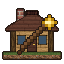

# weft-mods

Mods for [Weft](https://github.com/Weft-Rust/Weft), a voxel sandbox engine written in Rust.
Each mod is a native library built against Weft's SDK, and adds to the base game that Weft
ships as its own mod.

## The mods

| | Mod | What it adds |
|---|---|---|
|  | [Cogwork](cogwork/README.md) | Item tubes you can see into, engines, and machines that work for you: an excavator that mines out a whole area, an assembly bench that crafts on its own, and a leveler that makes land flat. |
|  | [Structures](structures/README.md) | Buildings and hamlets across the overworld, a wand and `/structure` command to save and place structures in the game, and `structures_api` for other mods to place their own. |
| | [Showcase](showcase/README.md) | A tool for mod makers: plays films that mods make of their content in code, and records them to video. |

Each mod's README gives an overview; Cogwork's and Structures' `docs/` folders describe every
feature, block and item in detail.

## Playing

1. Get Weft from its [releases](https://github.com/Weft-Rust/Weft/releases).
2. Download a mod's zip from the [downloads](#downloads) below, built against the same Weft.
3. Put the zip as it is into the game's `mods/` folder and start the game.

Every mod here needs the base game, which every Weft has, and none needs another. Showcase is
only needed to play a film.

## Building from source

The engine is the submodule `Weft/`, pinned to a Weft release. With Rust and Weft's build
requirements installed:

```
git submodule update --init Weft
./start.sh              # builds the engine and every mod, installs them and starts the game
./start.sh cogwork      # only this mod
```

A mod loads only into an engine built from the same Weft commit, so whenever `Weft/` moves,
rebuild the engine and the mods. [`docs/agents/mods.md`](docs/agents/mods.md) has the build, load
and check steps one by one.

## Repository layout

| Path | What it holds |
|---|---|
| `cogwork/`, `structures/`, `showcase/` | One mod each: its crate, `assets/`, README, and `docs/` where it has them |
| `Weft/` | The engine, as a submodule |
| `docs/agents/` | Guides for working on this repository: mods, code style, engine, testing |
| `tools/` | Formatting, the headless test run, film recording (`showcase.sh`) and CI scripts |
| `start.sh` | Builds, installs and starts everything |

## Contributing

Changes come as pull requests to `main`. Commits follow
[Conventional Commits](https://www.conventionalcommits.org), and `tools/fmt-changed.sh` formats
just the lines you changed. Keep `Weft/` at a Weft release: pull requests that move it
elsewhere are refused. CI builds every mod on Windows, Linux and macOS.

## Releases

Every push to `main` releases the mods that changed:

- A mod whose version has no release yet is released as that version: a full release
  (`X.Y.Z`), which needs `Weft/` at a Weft release, or a release candidate (`X.Y.Z-rc.N`).
- A mod that changed without a new version gets the next release candidate from CI.

Experimental builds follow Weft's upstream `master`. The section below is kept up to date by CI;
see [`docs/agents/mods.md`](docs/agents/mods.md#releasing) for the details.

<!-- mod-releases:start -->
## Downloads

Put a mod's zip as it is into the game's `mods/` folder; each one holds the Windows, Linux and
macOS builds. A mod loads only into a game with the same mod interface as the Weft it was built
against. Full releases are built against a released Weft. Release candidates (`X.Y.Z-rc.N`) are builds
of `main` on the way to the next release, and experimental builds use Weft's upstream `master`
instead of the Weft this repository pins.

| Mod | Release | Release candidate | Experimental |
|---|---|---|---|
| cogwork | [0.1.1](https://github.com/Zorro909/weft-mods/releases/tag/cogwork-v0.1.1), Weft 26.11.1 [ff9c712](https://github.com/Weft-Rust/Weft/commit/ff9c7128511fc0dce7719b67c9a59274d70bdd5a) | – | [0.1.1](https://github.com/Zorro909/weft-mods/releases/tag/cogwork-v0.1.1-experimental.090722d.5855730), Weft 26.11.1 [090722d](https://github.com/Weft-Rust/Weft/commit/090722d8954973e0badcd130446cbebbe0016181) |
| structures | [0.1.1](https://github.com/Zorro909/weft-mods/releases/tag/structures-v0.1.1), Weft 26.11.1 [ff9c712](https://github.com/Weft-Rust/Weft/commit/ff9c7128511fc0dce7719b67c9a59274d70bdd5a) | – | [0.1.1](https://github.com/Zorro909/weft-mods/releases/tag/structures-v0.1.1-experimental.090722d.5855730), Weft 26.11.1 [090722d](https://github.com/Weft-Rust/Weft/commit/090722d8954973e0badcd130446cbebbe0016181) |

## Versions

### cogwork

| Version | Released | Weft |
|---|---|---|
| [0.1.1](https://github.com/Zorro909/weft-mods/releases/tag/cogwork-v0.1.1) | 2026-11-02 | 26.11.1 [ff9c712](https://github.com/Weft-Rust/Weft/commit/ff9c7128511fc0dce7719b67c9a59274d70bdd5a) |
| [0.1.0](https://github.com/Zorro909/weft-mods/releases/tag/cogwork-v0.1.0) | 2026-11-02 | 26.10.4 [5faf2e3](https://github.com/Weft-Rust/Weft/commit/5faf2e3e57697dd3476b03a300f1231b84f6419e) |

### structures

| Version | Released | Weft |
|---|---|---|
| [0.1.1](https://github.com/Zorro909/weft-mods/releases/tag/structures-v0.1.1) | 2026-11-02 | 26.11.1 [ff9c712](https://github.com/Weft-Rust/Weft/commit/ff9c7128511fc0dce7719b67c9a59274d70bdd5a) |
| [0.1.0](https://github.com/Zorro909/weft-mods/releases/tag/structures-v0.1.0) | 2026-11-02 | 26.10.4 [5faf2e3](https://github.com/Weft-Rust/Weft/commit/5faf2e3e57697dd3476b03a300f1231b84f6419e) |

<!-- mod-releases:end -->
