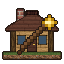

# Structgen

A Weft mod that fills the overworld with hamlets, villages and towns, each laid out afresh from
the land it stands on. Its 29 buildings are the engine's structure files
(`assets/structures/*.json`), so the engine's `/structure` command places, saves and finds
them like any other.

It needs the base game (`base`).

## Features

### In the world

Hamlets, villages and towns grow on the overworld's open plains, each laid out afresh: a
village green or a town's market square, roads winding out of it along the ground, buildings
facing the roads, gardens, small fields and a mill. Villages have gravel lanes, a church, a
tavern and a smithy; towns have cobbled streets, a town hall, a guildhall and a coaching inn.
All 29 buildings share one timber-framed style, and their roofs, frames and wall panels change
from one settlement to the next. One or two buildings of each settlement have something in
their chests.

### Making structures in the game

The engine's `/structure` saves a box of the world to a file, places a file or one of this
mod's buildings, takes it back again, and finds the nearest settlement. Structgen has no
commands of its own.

### For other mods

Everything structgen registers is the engine's, so another mod uses it with the SDK alone: the
templates `structgen:<name>` and their turned copies, the palettes `structgen:styles/...`, and
the features `structgen:hamlet`, `structgen:village` and `structgen:town` for
`w.structure_near` or `r.remove`.

Everything is worked out from the seed and the terrain, so the server and every client agree
on where settlements are without sending them.

## Getting started

1. Find a village: `/structure locate structgen:village`, then go there. The position is the
   settlement's start, at most 48 blocks off its middle along x and along z.
2. Look at a building: `/structure load structgen:hof ~ ~ ~` puts it with its lowest corner
   where you stand, `structgen:hof/right` turned. `/structure undo` takes it away.
3. Save one of your own: `/structure save my_house <from> <to>` with two opposite corners
   (`~ ~ ~` works) writes `structures/my_house.json` beside the game's saves, and
   `/structure load my_house` places it again.

## Documentation

The details are in [`docs/`](docs/README.md):

- [In the world](docs/worldgen.md): which buildings appear, and how hamlets, villages and towns
  are laid out
- [Commands](docs/commands.md): the engine's `/structure` with this mod's buildings
- [Adding a structure to this mod](docs/adding-structures.md)
- [Material slots](docs/materials.md): restyling a building with other blocks
- [How a place is chosen](docs/placement.md)
- [Structure files](docs/file-format.md): what structgen reads of the engine's files

## Layout

| Folder | What it holds |
|---|---|
| `src/` | the mod: the buildings' turned and paved copies, styles, hamlets, villages and towns |
| `assets/structures/` | the buildings, trees and tiles as the engine's structure files, also compiled into the mod |
| `examples/buildings/` | draws the mod's buildings, paths and streets in code, with the Hearthwood kit |
| `examples/shot_script/` | the game script `tools/structure-shots.sh` photographs them with |
| `examples/layouts/` | tiles laid side by side, for `structure-shots.sh --layout` |
| `examples/sketch/`, `examples/sketches/` | hand-drawn settlements turned into ground and layouts to shoot |
| `src/films/` | the showcase film, only with `--features showcase` |

## Showcase film

With the `showcase` feature, structgen brings a film for the [showcase](../showcase) mod: a
journey through seed 42's world as it generates, past two hamlets, two villages and a town and
into some of their buildings. It takes about 5:25. Record it with
`tools/showcase.sh structgen:showcase -- --view 32`, which makes a world of the showcase's own
seed, 42; the film only fits that seed's world. Without the feature, none of this is compiled
in, and showcase is not a dependency.

Its flight follows the settlements of the old layout. In 0.4.0 they stand in other places, so
the film has to be recorded again.

## Build and install

To play it, take the zip from the [releases](../README.md#downloads). To build it yourself,
from this folder, with the engine built in `../Weft` (see
[`docs/agents/mods.md`](../docs/agents/mods.md)):

```
cargo build --release
cargo test --release
mkdir -p ../Weft/run/mods/structgen
cp target/release/libstructgen.so ../Weft/run/mods/structgen/
cp -r assets ../Weft/run/mods/structgen/
```

The library is `libstructgen.so` on Linux; on Windows it is `structgen.dll`, on macOS
`libstructgen.dylib`. `../start.sh structgen` builds the engine and the mod, installs it and starts the
game, on any of the three.

## Status

Text is in English only so far. What is not done yet, and what structgen works around until
the engine can do it, is in [Not done yet](docs/README.md#not-done-yet) and
[Missing in the engine](docs/README.md#missing-in-the-engine).
